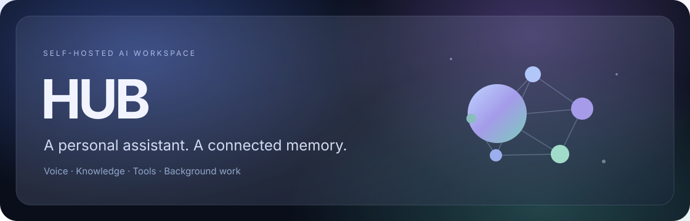
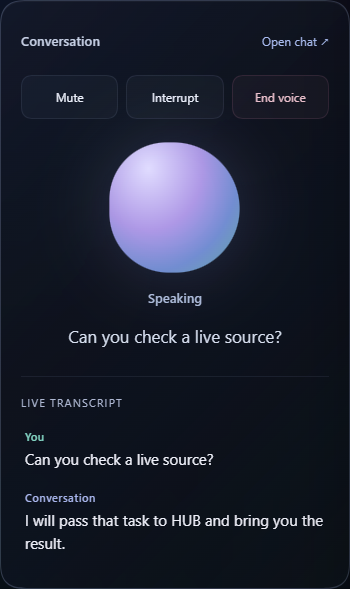
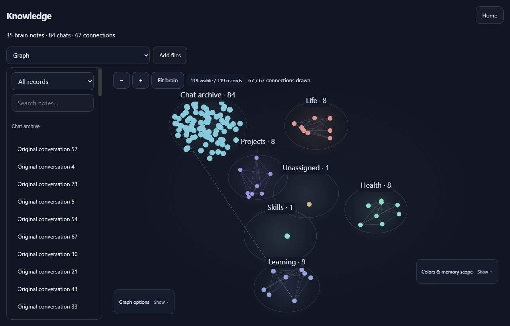
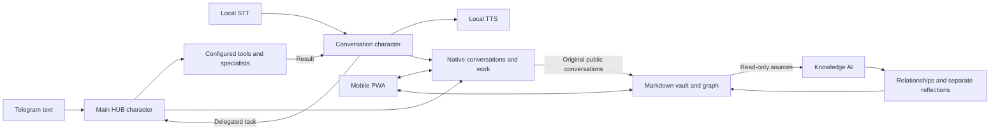

<p align="center">
  
</p>

<p align="center">
  <a href="LICENSE"></a>
  <a href="package.json"></a>
  <a href="docs/setup.md"></a>
  <a href="https://github.com/mbaykam/HUB/actions/workflows/check.yml"></a>
</p>

<p align="center">
  <a href="docs/setup.md">Get started</a> ·
  <a href="docs/README.md">Documentation</a> ·
  <a href="README.tr.md">Türkçe</a> ·
  <a href="https://github.com/mbaykam/HUB/issues">Issues</a>
</p>

**HUB is a self-hosted AI workspace for conversation, delegated work and connected knowledge.**
Talk to a fast voice companion, give your main assistant a task through Telegram,
and use the mobile PWA to follow the work, review conversations and explore your
second brain. Choose the models, voices and tools behind each character.

Built on [Minke](https://github.com/lencx/Minke) and
[DeepSeek Harness](https://github.com/deepseek-ai/deepseek-harness).
HUB is an independent project, maintained separately from both upstream teams.

## What you can do

| | In HUB |
| --- | --- |
| **Talk naturally** | Local speech recognition and synthesis, English/Turkish profiles, listenable voice previews and a live transcript. |
| **Delegate real work** | A quick conversation model hands demanding tasks to the configured HUB character. Native tasks retain their history and tool policy; completed results can return to the active voice session. |
| **Stay in Telegram** | A paired bot handles text and updates replies in place. An optional, separate Telegram user account supports incoming voice calls. |
| **Build a second brain** | Original conversations stay intact in an Obsidian-compatible vault. AI connects them and adds separate sourced reflections, with reviewable profile suggestions. |
| **Manage automations** | Schedule, repeat or watch conditions from the PWA right panel, with task permissions, limits and durable run history. |
| **Work toward a goal** | Choose a character, acceptance criteria, resources and allowance. Follow milestones and evidence across background rounds, with editable settings, approvals and separate recurring results. |
| **Choose your stack** | Browse OpenRouter metadata and installed provider catalogs; configure character routes, voices, tools and delegation. Native provider plugins and local LM Studio/Ollama routes remain available. |
| **Follow the work** | Review native tasks, open the related conversation, inspect browser work and view supported visual artifacts in the PWA. |
| **Explore live visuals** | Ask your assistant for diagrams or interactive charts in a conversation canvas. Follow updates as the agent publishes them, pause updates to explore a version, or reopen a dismissed visual. |

The conversation canvas supports passive HTML/SVG and self-contained Vega charts
with local sliders and selectors. It shares the active conversation with voice;
interactive controls do not require a model call. Visuals are scoped to their
conversation and stay available while that session is loaded. They run in a
sandbox without external network access or model-generated JavaScript.

### A quieter interface

Dark glass surfaces, a soft gradient mesh and a reactive voice orb. One state
message, a live transcript and controls that stay available while you move
between Home and a conversation. The PWA is the companion workspace for voice
and Telegram, with character and Knowledge AI settings kept out of the chat.

<table><tr>
  <td align="center" valign="top"><strong>Voice</strong><br><br></td>
  <td align="center" valign="top"><strong>Knowledge</strong><br><br></td>
</tr></table>

<p align="center"><sub>Real interface captures with synthetic demonstration content; no personal conversations or vault data.</sub></p>

## Get started

HUB is an **experimental, Windows-first source project**. Windows is the current
development and voice baseline. The desktop shell also has macOS/Linux packaging
paths; this snapshot does not provide verified voice support or prebuilt
downloads for those platforms.

Install [Node.js 24+](https://nodejs.org/), Git and pnpm **11.7.0**, then:

```sh
git clone --recurse-submodules https://github.com/mbaykam/HUB.git
cd HUB
pnpm install --frozen-lockfile
pnpm run harness:stage
pnpm start
```

Connect your model provider in Settings and configure the main HUB and
voice characters. Voice, knowledge curation and Telegram calls are
**optional extensions requiring their own local runtime/profile setup**; they
are not provisioned by the source command above.

In the mobile PWA, open **Settings → HUB → Assistants** for characters,
Knowledge AI, Telegram, provider usage and voice history. The right panel keeps
the Knowledge graph, Automations and [Goals](docs/goals.md) available for browsing
records, managing timed work and following longer outcomes.

Follow the [setup guide](docs/setup.md) for model configuration, authenticated
mobile access and optional capabilities. This repository includes code and
application assets; it does not bundle accounts, provider credentials, personal
profiles, conversations, vaults or speech-model weights.

## One host, several ways in



The host must be running. Remote microphone access needs HTTPS; Telegram calls
need an opted-in user account, separate from the bot. Voice and PWA can observe
the same call without opening a second microphone session.

## Models and data

Speech can run locally while the conversation model uses your selected provider.
Prompts and tool results go to that provider; Telegram messages go through
Telegram, and browsing reaches the selected websites. Local operation of speech
and storage does not make a hosted language model offline.

Knowledge AI has configurable source selection, timing, annotation language,
relationships, reflection, review mode and budgets. Original conversations are
archived even when a model fails; Curator cannot rewrite them. ChatGPT/Gemini
archives can be imported explicitly. See [Knowledge](docs/knowledge.md),
[Automations](docs/automations.md) and [Voice](docs/voice.md).

HUB uses the native Harness permission model. Tools and trusted plugins can
operate on the host with the permissions you grant. Keep credentials and runtime
data outside the checkout, approve Telegram pairing deliberately, and use
authenticated remote access. Read [SECURITY.md](SECURITY.md).

## Development

```sh
pnpm typecheck
pnpm test:desktop
pnpm run package
```

`test:desktop` includes core, Harness, UI, host and native-service checks.
Provider/microphone integration checks are separate opt-ins; ordinary source
tests use fixtures. On Windows without file-symlink privileges, the specific
filesystem-link cases report a skip; Unix CI covers those cases.

See [CONTRIBUTING.md](CONTRIBUTING.md), the
[UI design guide](UI_DESIGN_GUIDE.md) and
[compatible PWA update guide](HUB_UI_UPDATES.md).

## Status and next work

Voice latency and recognition depend on the selected models, host and network.
The current playback guard pauses recognition during replies rather than
providing full acoustic echo cancellation. Interrupt remains explicit.
Long-session compaction, direct character handover and broader platform
acceptance remain ongoing work; they are not promised by this snapshot.

The [changelog](CHANGELOG.md) records the current source baseline.

## Credits and references

- [Minke](https://github.com/lencx/Minke) — the original desktop shell and product foundation, by lencx.
- [DeepSeek Harness](https://github.com/deepseek-ai/deepseek-harness) — plugin composition, native agents, sessions and tools; the submodule is pinned in [runtime configuration](config/harness-runtime.json).
- [Pi](https://github.com/earendil-works/pi) — the provider/agent ecosystem used through the underlying Harness.
- [Pipecat](https://github.com/pipecat-ai/pipecat) — the local voice pipeline; [Cytoscape.js](https://js.cytoscape.org/) — graph infrastructure.

README presentation references: [OpenClaw](https://github.com/openclaw/openclaw/blob/main/README.md),
[OpenCode](https://github.com/anomalyco/opencode/blob/dev/README.md) and
[Pi](https://github.com/earendil-works/pi/blob/main/README.md). These inspired the
product overview, quick start and documentation layout; their branding and copy
are not reused. See [sources](docs/sources.md) for links and component credits.

HUB code is licensed under [Apache-2.0](LICENSE). Upstream components and optional
model weights retain their own licenses; see [NOTICE](NOTICE) and bundled
[license notices](resources/licenses/).
