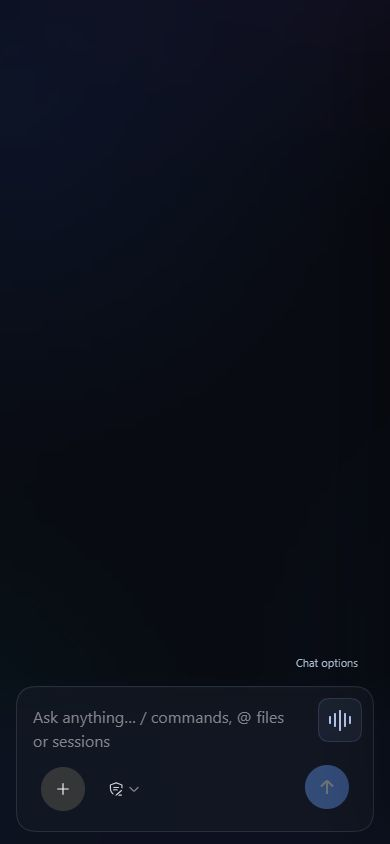
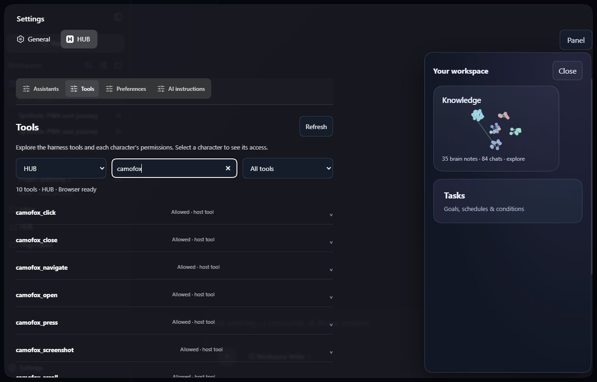
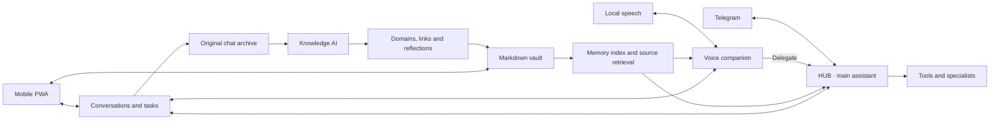

<p align="center">
  
</p>

<p align="center"><strong>A self-hosted personal assistant for voice, Telegram and a connected second brain.</strong></p>

<p align="center">
  <a href="https://github.com/mbaykam/HUB/actions/workflows/check.yml"></a>
  <a href="LICENSE"></a>
  <a href="#get-started"></a>
  <a href="https://github.com/mbaykam"></a>
</p>

<p align="center">
  <a href="#get-started">Get started</a> &nbsp;·&nbsp;
  <a href="docs/README.md">Documentation</a> &nbsp;·&nbsp;
  <a href="README.tr.md">Türkçe</a> &nbsp;·&nbsp;
  <a href="https://github.com/mbaykam/HUB/issues">Report an issue</a>
</p>

Talk to your voice companion. Give HUB a task in Telegram. Open the PWA to follow
the work, inspect a source or explore how your knowledge connects. The same host
holds the conversations, character settings and tools behind each interaction.

Created and maintained by **[Mete Baykam (@mbaykam)](https://github.com/mbaykam)**.
HUB builds on [Minke](https://github.com/lencx/Minke) and
[DeepSeek Harness](https://github.com/deepseek-ai/deepseek-harness), with its own
personal-assistant interface and extensions.

## A workspace for your second brain

<p align="center">
  
</p>

Knowledge stays in an **Obsidian-compatible Markdown vault**. Original chats live
in their own archive, outside your life domains. Notes can link back to the
conversation or file they came from. Knowledge AI organizes relationships and
separate reflections without rewriting your original conversations.

A generated **`memory.md`** gives characters a compact, current map of the vault.
They retrieve the relevant sources when needed. Reusable workflows live in the
**Skills** domain as portable `SKILL.md` files that you and your characters can
find, inspect and update.

## Speak, write, follow the work

<table>
  <tr>
    <td align="center" valign="top" width="50%">
      <strong>One place to begin</strong><br>
      <sub>Write and Speak share a bottom bar. Home stays clear until there is work to show.</sub><br><br>
      
    </td>
    <td align="center" valign="top" width="50%">
      <strong>Stay in the conversation</strong><br>
      <sub>See the live transcript and open the related chat while a call continues.</sub><br><br>
      
    </td>
  </tr>
</table>

<p align="center"><sub>Current PWA screenshots with demonstration data. The voice screen uses simulated call state; no personal conversations or vault data are shown.</sub></p>

| Capability | How it works |
| --- | --- |
| **Multilingual voice** | Local speech recognition and synthesis, language detection, prepared voice samples and a live transcript. Available languages depend on the selected engines. |
| **Telegram** | Paired text conversations with replies updated in place. An optional, separate Telegram user account provides incoming voice calls. |
| **Characters and delegation** | Choose a model, voice and tool policy for each character. A fast voice companion can hand deeper work to HUB while preserving the native task history. |
| **Goals and routines** | One Tasks panel for ongoing outcomes, schedules, recurring work and conditions. Choose a character, resources, limits and completion criteria; follow the evidence and run history. |
| **Practical tools** | Inspect effective tool access in Settings. Browser tools read pages, use observed controls, fill fields and return screenshots. Supported video attachments can provide timestamped frames and local transcription. |
| **Live visuals** | Agents can publish diagrams, passive HTML/SVG and self-contained Vega charts into a conversation canvas. Local sliders and selectors work without another model request. |
| **Long conversations** | Native context compaction reduces older working context while retaining original session history. Domain-aware retrieval and the memory index complement the checkpoint. |

<details>
<summary><strong>Inside Settings: see what your characters can use</strong></summary>
<br>


The inventory comes from registered tools and character policy. Registration,
permission and runtime readiness are shown separately; execution still respects
task restrictions and approval rules. See [memory, skills and context](docs/MEMORY_SKILLS_AND_CONTEXT.md).
</details>

## Get started

HUB is an **experimental, Windows-first source project**. Install
[Node.js 24+](https://nodejs.org/), Git and pnpm **11.7.0**:

```sh
git clone --recurse-submodules https://github.com/mbaykam/HUB.git
cd HUB
pnpm install --frozen-lockfile
pnpm run harness:stage
pnpm start
```

Connect a provider, then configure your characters in **Settings → HUB**. Use
the authenticated mobile PWA and Telegram for everyday interaction; the host
computer runs the background work.

Local voice, Knowledge AI and Telegram calls are optional extensions with their
own runtime/profile setup. The commands above do not install model weights or
provision accounts. Follow the [setup guide](docs/setup.md) and the
[voice](docs/voice.md), [Telegram](docs/telegram.md) and
[Knowledge](docs/knowledge.md) guides.

## How the pieces connect



Your conversations, vault and local speech stay on the host. Prompts and tool
results reach the language-model provider you select; Telegram and web browsing
use their respective services. Local storage does not make a cloud model offline.
Accounts, credentials, personal records and model weights are excluded from this
repository. See [SECURITY.md](SECURITY.md).

<details>
<summary><strong>Current boundaries</strong></summary>

- The host must stay on for calls and background tasks. Remote microphone access needs authenticated HTTPS.
- Speech speed and recognition depend on the selected models and hardware. The playback guard pauses recognition during replies; it is not full acoustic echo cancellation.
- Browser tools control websites, not arbitrary Windows applications. A platform can block access to a reel; attach the clip when that happens. Sampled frames do not establish every moment of a video.
- Compaction is lossy and can require an extra model request. Original history and cited sources remain the recovery path; a simulated test is not a full-day physical call test.
- macOS/Linux packaging paths exist, but this snapshot does not claim verified voice support or prebuilt downloads for those platforms.
- Conversation visuals are scoped to the loaded session and sandboxed without external network access or model-generated JavaScript.

</details>

## Development and contributing

```sh
pnpm typecheck
pnpm test:desktop
pnpm run package
```

The suite covers core, Harness, UI, host and native-service behavior. Ordinary
tests use fixtures; provider, microphone and device checks are separate. Some
platform-dependent tests may report a skip.

[Contributing](CONTRIBUTING.md) · [UI design guide](UI_DESIGN_GUIDE.md) ·
[PWA updates](HUB_UI_UPDATES.md) · [Changelog](CHANGELOG.md) ·
[All contributors](https://github.com/mbaykam/HUB/graphs/contributors)

## Credits

- **[Mete Baykam](https://github.com/mbaykam)** — HUB creator and maintainer.
- **[lencx / Minke](https://github.com/lencx/Minke)** — the original desktop shell and product foundation.
- **[DeepSeek Harness](https://github.com/deepseek-ai/deepseek-harness)** — native agents, sessions, plugin composition and tool infrastructure.
- [Pi](https://github.com/earendil-works/pi), [Pipecat](https://github.com/pipecat-ai/pipecat) and [Cytoscape.js](https://js.cytoscape.org/) — provider, voice and graph foundations.

Presentation references: [OpenClaw](https://github.com/openclaw/openclaw/blob/main/README.md),
[OpenCode](https://github.com/anomalyco/opencode/blob/dev/README.md) and
[Pi](https://github.com/earendil-works/pi/blob/main/README.md). Their branding and
copy are not reused. Component and research links are collected in
[sources](docs/sources.md).

HUB code uses [Apache-2.0](LICENSE). Upstream components and optional model weights
retain their own licenses; see [NOTICE](NOTICE) and
[license notices](resources/licenses/).
